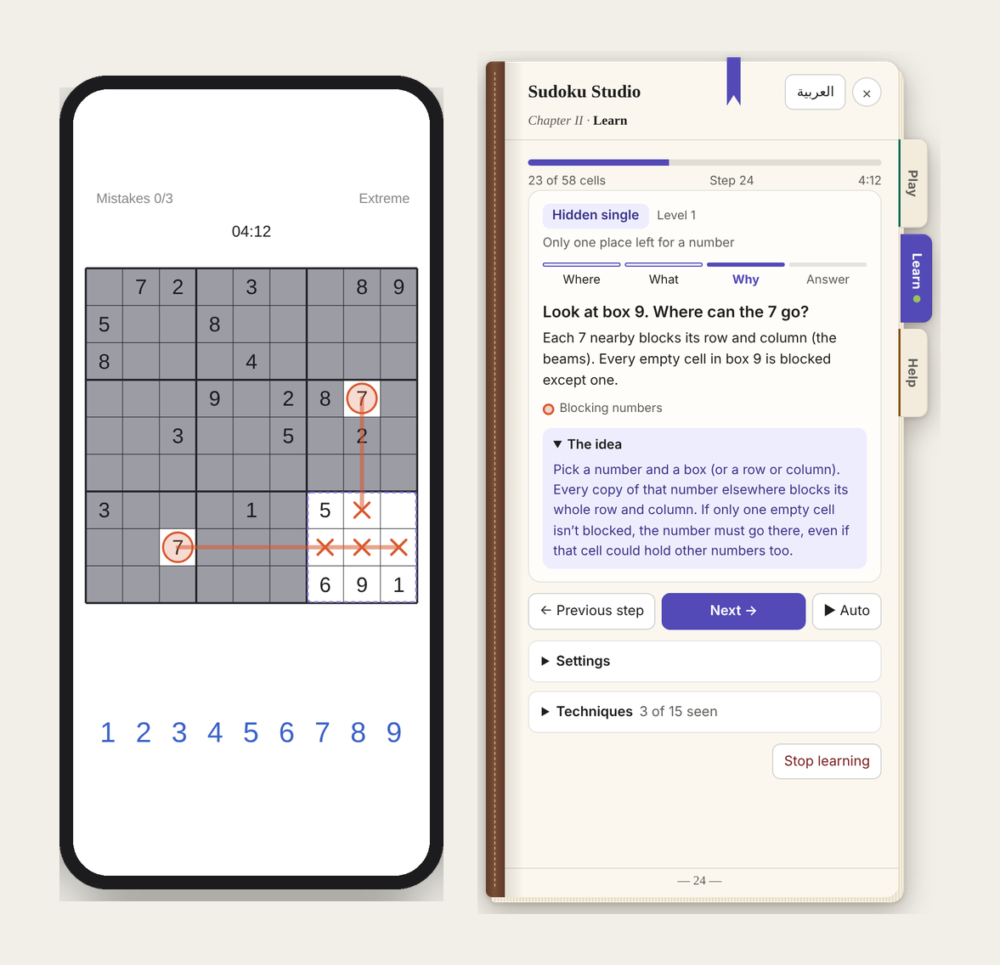
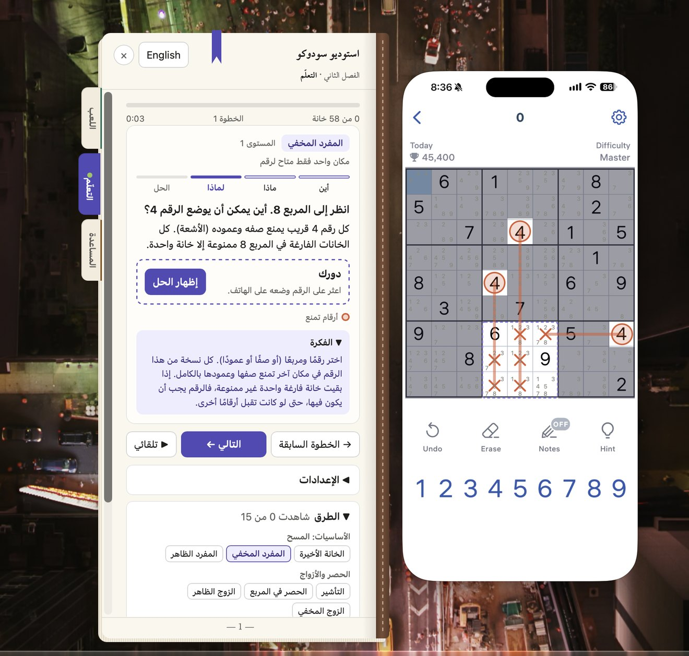
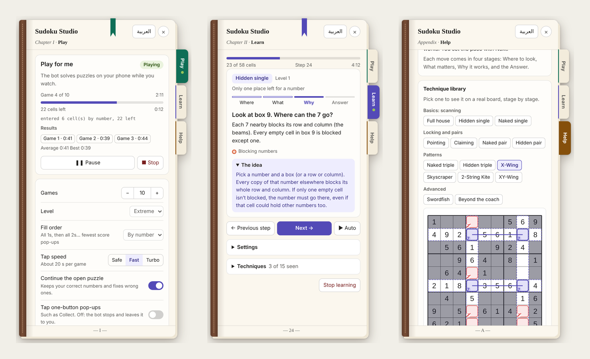
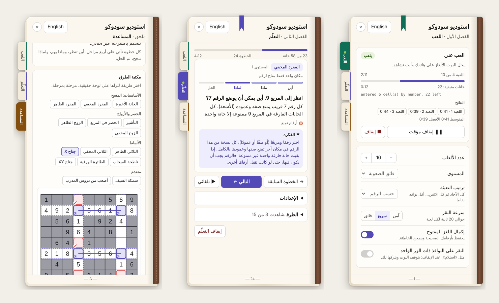
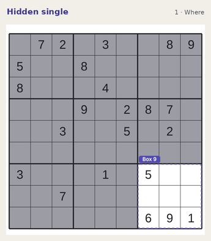
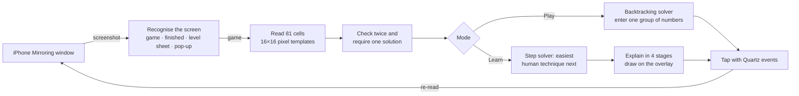

<div align="center">

# Sudoku Studio

**Play, learn and test Sudoku on your iPhone, from your Mac. No AI, just rules.**

[العربية](README.md) · **English**

[](https://github.com/alivx/sudoku-studio/actions/workflows/tests.yml)
[](LICENSE)




</div>

Sudoku Studio works with a Sudoku game running on your iPhone through macOS **iPhone Mirroring**.
It reads the board from the screen, finds the next move with plain logic, and either plays the move
for you or teaches it to you one step at a time, drawing the reasoning right on top of the game.

It started as a test harness for an iPhone Sudoku game in development and grew a coach on the way.

## Real example

<p align="center">
  <br>
  <sub>A real run on macOS with iPhone Mirroring, Master level. The Learn chapter is in Arabic and in
  <i>Me</i> mode: it explains a hidden single in box 8 and waits for you to place the 4 on the phone.
  The circles, beams and crosses are drawn by Sudoku Studio on top of the mirrored game.</sub>
</p>

## Contents

- [Real example](#real-example)
- [Features](#features)
- [Screenshots](#screenshots)
- [Requirements](#requirements)
- [Install](#install)
- [Usage](#usage)
- [How it works](#how-it-works)
- [Techniques the coach teaches](#techniques-the-coach-teaches)
- [Fitting it to your game](#fitting-it-to-your-game)
- [Project layout](#project-layout)
- [Development](#development)
- [Safety and privacy](#safety-and-privacy)
- [Roadmap](#roadmap)
- [Contributing](#contributing) · [License](#license)

## Features

**Chapter I: Play**
- Plays a batch of games end to end: picks the level, solves, enters numbers, starts the next game
- Fill order by number, row, column, box or snake, at three tap speeds
- Re-reads the board after every group of taps, so dropped taps and pop-ups are caught and repaired
- Continues a half-played puzzle and fixes wrong entries
- Per-game results with times, average and best

**Chapter II: Learn**
- One move at a time in four stages: *Where to look*, *What it is*, *Why it works*, *The answer*
- You press **Next**; auto-advance is optional, never forced
- Arrows, crosses and highlights drawn over the real game with a click-through layer
- *Me* mode: you place the number on the phone; the coach checks it and offers *Show answer*
- Step back through earlier moves, remembers removed options, can speed up the easy steps you know
- Explains a wrong number when it finds one

**Appendix: Help**
- Ready check for Accessibility, Screen Recording, the mirroring window and the board, each with a fix button
- Technique library with a real board for each of the 15 techniques, played stage by stage
- Keys and troubleshooting

**Everywhere**
- English and Arabic with full right-to-left layout, and optional Arabic-Indic digits
- A small book-shaped window: leather spine, index tabs, bookmark ribbons and page turns
- Solves with logic you can follow. No AI model, no network calls

## Screenshots

<p align="center">
  <br>
  <sub>Play, Learn and Help in English</sub>
</p>

<p align="center">
  <br>
  <sub>The same chapters in Arabic, right to left</sub>
</p>

<p align="center">
  <br>
  <sub>The technique library plays each pattern on a real board.</sub>
</p>

## Requirements

- A Mac with **macOS 15 Sequoia or later** and **iPhone Mirroring** set up with your iPhone
- **Python 3.10+**
- The Sudoku game open on the phone, shown in the iPhone Mirroring window
- Two macOS permissions for the app that runs the script (usually Terminal):
  **Accessibility** (to tap) and **Screen Recording** (to read the screen)

> [!NOTE]
> The screen positions are calibrated for one specific game layout. Other Sudoku apps will need the
> numbers in [Fitting it to your game](#fitting-it-to-your-game) adjusted.

## Install

```bash
git clone https://github.com/alivx/sudoku-studio.git
cd sudoku-studio
python3 -m venv .venv
.venv/bin/pip install -r requirements.txt
```

Then give Terminal the two permissions in **System Settings → Privacy & Security**:
**Accessibility** and **Screen Recording**. Restart Terminal after changing them.
The Help chapter's ready check tells you which one is missing and opens the right settings page.

## Usage

### The app

Double-click **`Sudoku.command`** in Finder, or run:

```bash
.venv/bin/python sudoku_app.py            # Play, Learn and Help
.venv/bin/python sudoku_app.py --lang ar  # start in Arabic
.venv/bin/python sudoku_app.py --demo     # try Learn and Help without a phone
```

Open iPhone Mirroring first, start a game on the phone, then choose **Play** or **Learn** in the book.
Only one of them uses the phone at a time; starting one stops the other.

**Keys while learning** (click the book first)

| Key | Action |
|---|---|
| <kbd>Space</kbd> or <kbd>→</kbd> | Next |
| <kbd>←</kbd> | Previous step |
| <kbd>A</kbd> | Show answer |
| <kbd>P</kbd> | Auto-advance on or off |
| <kbd>L</kbd> | Switch language |

In Arabic the arrow keys follow the reading direction.

### Command line

The autoplayer and the coach also run on their own:

```bash
# autoplayer
.venv/bin/python sudoku_auto.py --dry-run                     # show what it sees and would tap; taps nothing
.venv/bin/python sudoku_auto.py --games 10 --level extreme
.venv/bin/python sudoku_auto.py --pattern snake --delay 0.2   # slower taps if some get dropped
.venv/bin/python sudoku_auto.py --resume-open                 # continue a puzzle already in progress

# coach in its own panel
.venv/bin/python coach.py --placer me     # you place every number
.venv/bin/python coach.py --demo          # practice puzzle, no phone
```

Run any of them with `--help` for every option. Move the mouse to pause the autoplayer; press
<kbd>Ctrl</kbd>+<kbd>C</kbd> to stop it.

## How it works



- **Reading the board.** Each cell is cropped from a screenshot of the mirroring window and matched
  against small pixel templates of the digits 1 to 9. Clues and your entries are told apart by colour.
  The board is read twice and must have exactly one solution before anything is tapped.
- **Playing.** A fast bitmask backtracking solver finds the full solution. Numbers are entered in
  groups, and the board is read again after each group to catch dropped taps or pop-ups.
- **Teaching.** [`logic.py`](logic.py) looks for the easiest technique a person would use next,
  from full house up to swordfish. Every step is checked against the full solution before it is
  shown, so a bug in a detector can never teach a wrong move.
- **Drawing.** A transparent, click-through window sits on top of the phone and draws the step with
  SVG. The book UI is HTML in a WebKit view, talking to Python through a message handler.
- **Safety.** It never taps an unknown screen, pauses when you move the mouse, stops if the same tap
  changes nothing, and saves a screenshot to `debug/` when it gets stuck.

## Techniques the coach teaches

| Level | Technique | In one line |
|:-:|---|---|
| 1 | Full house | The last empty cell in a group |
| 1 | Hidden single | Only one place left for a number |
| 1 | Naked single | Only one number fits a cell |
| 2 | Pointing | A number locked to one line inside a box |
| 2 | Claiming | A line locks a number into one box |
| 2 | Naked pair | Two cells sharing the same two numbers |
| 2 | Hidden pair | Two numbers with only two homes |
| 3 | Naked triple | Three cells sharing three numbers |
| 3 | Hidden triple | Three numbers with only three homes |
| 3 | X-Wing | Two lines, two cross-lines, one number |
| 3 | Skyscraper | Two lines joined at the base |
| 3 | 2-String Kite | A row and a column tied in one box |
| 3 | XY-Wing | Three cells with two options each |
| 4 | Swordfish | An X-Wing with three lines |
| 5 | Beyond the coach | Shows the answer when only a long chain would do |

The coach also points out a wrong number on the board before anything else.

## Fitting it to your game

All screen positions live at the top of [`sudoku_auto.py`](sudoku_auto.py), measured in a
339 × 747 frame that matches the iPhone Mirroring window:

| Constant | Meaning |
|---|---|
| `GRID` | Board rectangle `(left, top, right, bottom)` |
| `XS`, `YS` | Centres of the 9 columns and 9 rows |
| `PAD_Y`, `padx(d)` | Number pad row and the x position of digit `d` |
| `CENT` | Digit templates (16 × 16, one row per digit) |

Start with `--dry-run`: it prints what it read and where it would tap, without tapping.
If digits are misread, rebuild `CENT` from a screenshot of your game.

## Project layout

```text
sudoku-studio/
├── sudoku_app.py        # Sudoku Studio: the book window, runs Play or Learn
├── sudoku_auto.py       # autoplayer: screen reading, solver, taps (also a CLI)
├── coach.py             # coach: lessons, progress, settings (also a CLI)
├── logic.py             # step solver with 15 human techniques
├── Sudoku.command       # double-click launcher for macOS
├── README.md            # Arabic README (shown first on GitHub)
├── README.en.md         # this file
├── web/
│   ├── app.html         # the book UI (Play, Learn, Help)
│   ├── panel.html       # the coach's standalone panel
│   ├── overlay.html     # click-through drawing layer over the phone
│   ├── board.js         # shared SVG board renderer
│   ├── examples.js      # real boards for the technique library (generated)
│   └── i18n.js          # English and Arabic text
├── tools/
│   ├── puzzles.py       # puzzle generator and checker used by tests and tools
│   └── gen_examples.py  # rebuilds web/examples.js
├── tests/               # pytest suite, runs without a Mac or a phone
└── docs/images/         # README images
```

Settings, progress and logs (`app_settings.json`, `coach_*.json`, `*.log`, `debug/`) are written next to
the scripts and are ignored by git.

## Development

```bash
.venv/bin/pip install -r requirements-dev.txt
.venv/bin/python -m pytest
```

The tests cover the step solver on fixed and generated puzzles, the coach on the practice puzzle
(manual Next, *Me* mode, review, errors), the app controller with a stand-in bot, and the
autoplayer's solver. They need only `numpy` and `pillow`, so they also run on Linux in CI.

All text lives in [`web/i18n.js`](web/i18n.js), in an `en` and an `ar` block. Improve a translation
there and keep the `{placeholders}` as they are. A third language also needs the language switch in
`sudoku_app.py` and `web/app.html` extended.

## Safety and privacy

- Everything runs locally. There are no network calls and no telemetry.
- Logs and debug screenshots stay in the project folder. Screenshots can show whatever is in the
  mirroring window, so check them before sharing in an issue.
- Pop-ups with two buttons get the secondary choice (*Later*, *No thanks*). Pop-ups with a single
  button stop the run unless you allow them. Anything else stops the run.
- It is built for testing and learning with a game you own or have permission to automate. Respect
  the terms of any game you use it with and don't use it on competitive leaderboards.

See [SECURITY.md](SECURITY.md) to report a vulnerability.

## Roadmap

- [ ] Calibration helper that measures `GRID`, `XS`, `YS` and the pad from one screenshot
- [ ] Rebuild digit templates from a screenshot
- [ ] More techniques: W-Wing, unique rectangle, simple colouring
- [ ] Packaged `.app` bundle
- [ ] More languages

## Contributing

Issues and pull requests are welcome. Please read [CONTRIBUTING.md](CONTRIBUTING.md) first.

## License

[MIT](LICENSE) © 2026 Ali Baker

Not affiliated with Apple or with any Sudoku game publisher. iPhone and macOS are trademarks of Apple Inc.

