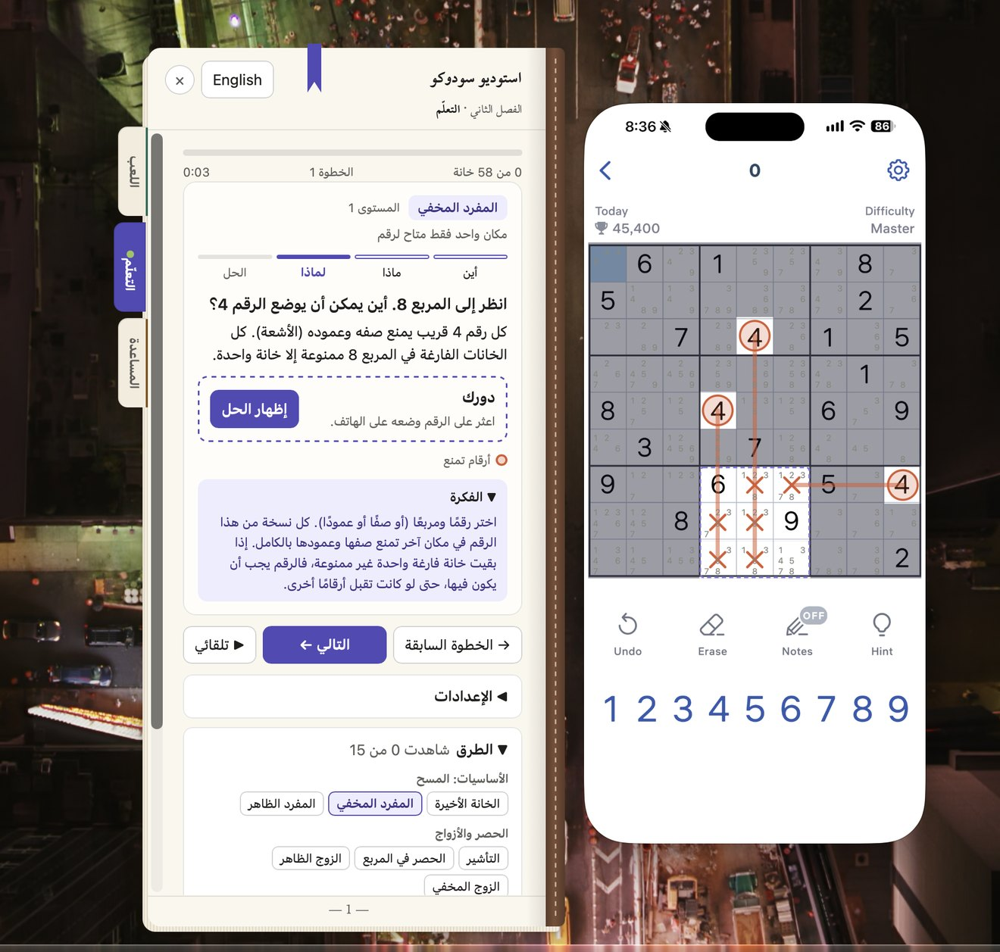
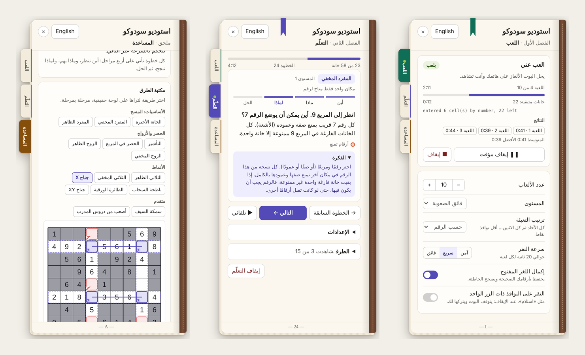
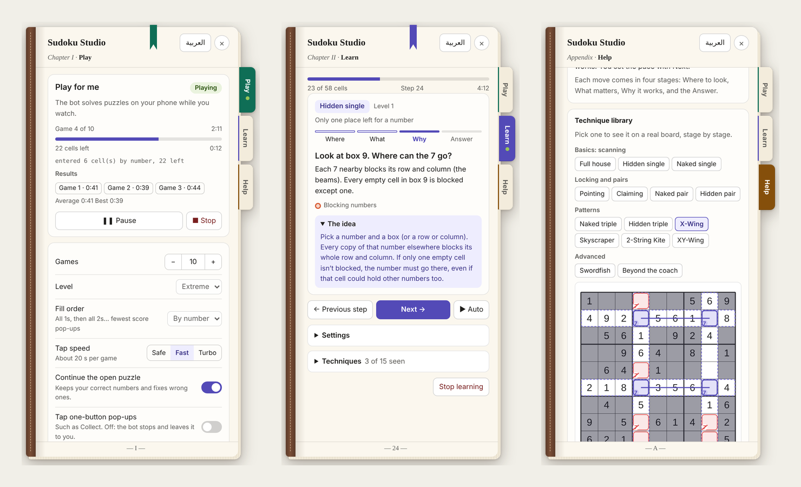
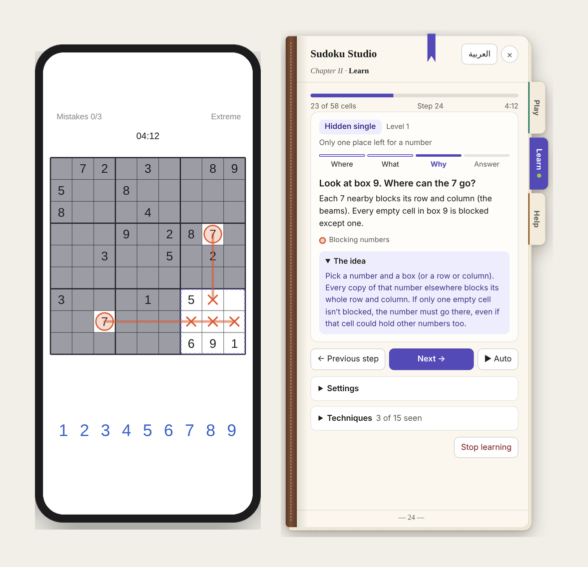
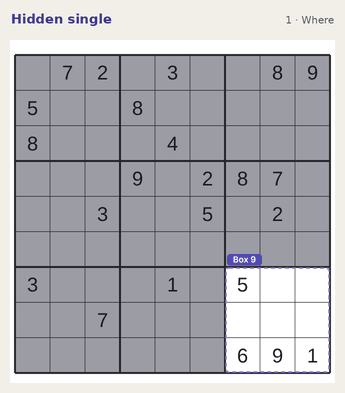
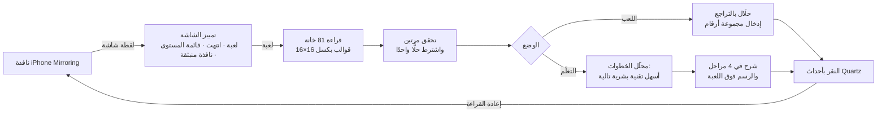

<div align="center">

# استوديو سودوكو · Sudoku Studio

**العب سودوكو على الآيفون وتعلّمها واختبرها من الماك. بلا ذكاء اصطناعي، بالمنطق وحده.**

**العربية** · [English](README.en.md)

[](https://github.com/alivx/sudoku-studio/actions/workflows/tests.yml)
[](LICENSE)




<sub>لقطة حقيقية على macOS مع iPhone Mirroring بمستوى Master: فصل التعلّم بالعربية في وضع «دورك» يشرح المفرد المخفي في المربع 8،
وينتظرك لتضع الرقم 4 على الهاتف. الدوائر والأشعة وعلامات X يرسمها استوديو سودوكو فوق اللعبة نفسها.</sub>

</div>

<div dir="rtl">

يعمل استوديو سودوكو مع لعبة سودوكو على الآيفون تظهر على الماك من خلال **iPhone Mirroring**.
يقرأ اللوحة من الشاشة، ويجد الحركة التالية بالمنطق، ثم إمّا أن يلعبها عنك وإمّا أن يعلّمك إياها
خطوة خطوة ويرسم طريقة التفكير فوق اللعبة مباشرة.

بدأ أداةً لاختبار لعبة سودوكو قيد التطوير على الآيفون، ثم صار معه مدرّب.

## المحتويات

- [المزايا](#المزايا)
- [لقطات الشاشة](#لقطات-الشاشة)
- [المتطلبات](#المتطلبات)
- [التثبيت](#التثبيت)
- [الاستخدام](#الاستخدام)
- [كيف يعمل](#كيف-يعمل)
- [التقنيات التي يعلّمها المدرب](#التقنيات-التي-يعلّمها-المدرب)
- [ضبطه على لعبتك](#ضبطه-على-لعبتك)
- [هيكل المشروع](#هيكل-المشروع)
- [التطوير](#التطوير)
- [الأمان والخصوصية](#الأمان-والخصوصية)
- [الخطة القادمة](#الخطة-القادمة)
- [المساهمة](#المساهمة) · [الترخيص](#الترخيص)

## المزايا

**الفصل الأول: اللعب**
- يلعب مجموعة ألعاب من البداية إلى النهاية: يختار المستوى، ويحلّ، ويدخل الأرقام، ويبدأ اللعبة التالية
- ترتيب الإدخال حسب الرقم أو الصف أو العمود أو المربع أو بشكل متعرّج، بثلاث سرعات للنقر
- يعيد قراءة اللوحة بعد كل مجموعة نقرات، فيكتشف النقرات الضائعة والنوافذ المنبثقة ويصلحها
- يكمل لغزًا بدأته ويصحّح الأرقام الخاطئة
- نتائج كل لعبة مع الوقت والمتوسط وأفضل وقت

**الفصل الثاني: التعلّم**
- حركة واحدة في كل مرة على أربع مراحل: **أين** تنظر، **ماذا** ترى، **لماذا** تنجح، و**الحل**
- أنت تضغط **التالي**؛ التقدّم التلقائي اختياري ولا يُفرض عليك
- أسهم وعلامات X وتظليل تُرسم فوق اللعبة الحقيقية في طبقة لا تعيق النقر
- وضع **دورك**: تضع الرقم بنفسك على الهاتف، ويتحقق المدرب منه ويعرض **إظهار الحل**
- الرجوع إلى الخطوات السابقة، وتذكّر الخيارات المحذوفة، وتسريع الخطوات السهلة التي تعرفها
- ينبّهك إلى الرقم الخاطئ حين يجده

**الملحق: المساعدة**
- فحص الجاهزية لصلاحيتي إمكانية الوصول وتسجيل الشاشة ونافذة المرآة واللوحة، مع زر إصلاح لكل منها
- مكتبة تقنيات فيها لوحة حقيقية لكل تقنية من الخمس عشرة، تُعرض مرحلةً مرحلة
- المفاتيح وحلّ المشكلات

**في كل مكان**
- العربية والإنجليزية مع اتجاه كامل من اليمين إلى اليسار، وأرقام عربية هندية اختيارية
- نافذة صغيرة على شكل كتاب: كعب جلدي، وألسنة فهرس، وأشرطة إشارة، وتقليب صفحات
- يحلّ بمنطق تستطيع متابعته. لا نموذج ذكاء اصطناعي ولا اتصال بالشبكة

## لقطات الشاشة

</div>

<p align="center">
  <br>
  <sub>اللعب والتعلّم والمساعدة بالعربية</sub>
</p>

<p align="center">
  <br>
  <sub>الفصول نفسها بالإنجليزية</sub>
</p>

<p align="center">
  
  &nbsp;
  <br>
  <sub>المدرب فوق اللعبة، ومكتبة التقنيات تعرض كل نمط على لوحة حقيقية</sub>
</p>

<div dir="rtl">

## المتطلبات

- جهاز ماك بنظام **macOS 15 Sequoia أو أحدث**، مع إعداد **iPhone Mirroring** للآيفون
- **Python 3.10** أو أحدث
- لعبة السودوكو مفتوحة على الهاتف وظاهرة في نافذة iPhone Mirroring
- صلاحيتان في macOS للتطبيق الذي يشغّل السكربت (عادةً Terminal):
  **إمكانية الوصول** (للنقر) و**تسجيل الشاشة** (لقراءة الشاشة)

> **ملاحظة:** مواضع الشاشة مضبوطة على تصميم لعبة واحدة بعينها. الألعاب الأخرى تحتاج تعديل
> الأرقام المذكورة في [ضبطه على لعبتك](#ضبطه-على-لعبتك).

## التثبيت

</div>

<div dir="ltr">

```bash
git clone https://github.com/alivx/sudoku-studio.git
cd sudoku-studio
python3 -m venv .venv
.venv/bin/pip install -r requirements.txt
```

</div>

<div dir="rtl">

ثم امنح Terminal الصلاحيتين من **إعدادات النظام ← الخصوصية والأمان**: **إمكانية الوصول** و**تسجيل الشاشة**،
وأعد تشغيل Terminal بعد تغييرهما. فحص الجاهزية في فصل المساعدة يخبرك بالصلاحية الناقصة ويفتح صفحة الإعداد الصحيحة.

## الاستخدام

### التطبيق

انقر نقرًا مزدوجًا على **`Sudoku.command`** في Finder، أو شغّل:

</div>

<div dir="ltr">

```bash
.venv/bin/python sudoku_app.py --lang ar  # بالعربية
.venv/bin/python sudoku_app.py            # Play, Learn and Help
.venv/bin/python sudoku_app.py --demo     # التعلّم والمساعدة بلا هاتف
```

</div>

<div dir="rtl">

افتح iPhone Mirroring أولًا، وابدأ لعبة على الهاتف، ثم اختر **اللعب** أو **التعلّم** من الكتاب.
يستخدم الهاتفَ واحدٌ منهما فقط في كل مرة، وتشغيل أحدهما يوقف الآخر.

**المفاتيح أثناء التعلّم** (انقر على الكتاب أولًا)

| المفتاح | الإجراء |
|---|---|
| <kbd>مسافة</kbd> أو <kbd>←</kbd> | التالي |
| <kbd>→</kbd> | الخطوة السابقة |
| <kbd>A</kbd> | إظهار الحل |
| <kbd>P</kbd> | تشغيل التقدّم التلقائي أو إيقافه |
| <kbd>L</kbd> | تغيير اللغة |

هذه أسهم الواجهة العربية، فهي تتبع اتجاه القراءة. في الواجهة الإنجليزية ينعكس اتجاهها.

### سطر الأوامر

يمكن تشغيل اللاعب الآلي والمدرب كلٍّ على حدة:

</div>

<div dir="ltr">

```bash
# اللاعب الآلي
.venv/bin/python sudoku_auto.py --dry-run                     # يعرض ما يراه وأين سينقر، دون نقر
.venv/bin/python sudoku_auto.py --games 10 --level extreme
.venv/bin/python sudoku_auto.py --pattern snake --delay 0.2   # نقر أبطأ إذا ضاعت بعض النقرات
.venv/bin/python sudoku_auto.py --resume-open                 # أكمل لغزًا بدأته

# المدرب في لوحته الخاصة
.venv/bin/python coach.py --lang ar --placer me   # أنت تضع كل رقم
.venv/bin/python coach.py --demo                  # لغز تدريبي بلا هاتف
```

</div>

<div dir="rtl">

شغّل أيًّا منها مع ‎`--help`‎ لعرض كل الخيارات. حرّك الفأرة لإيقاف اللاعب الآلي مؤقتًا، واضغط
<kbd>Ctrl</kbd>+<kbd>C</kbd> لإيقافه.

## كيف يعمل

</div>



<div dir="rtl">

- **قراءة اللوحة:** تُقصّ كل خانة من لقطة شاشة لنافذة المرآة وتُطابَق مع قوالب بكسل صغيرة للأرقام من 1 إلى 9،
  ويُفرَّق بين أرقام اللغز وأرقامك باللون. تُقرأ اللوحة مرتين ويجب أن يكون لها حل واحد فقط قبل أي نقرة.
- **اللعب:** حلّال سريع بالتراجع يعتمد على أقنعة البتات يجد الحل الكامل. تُدخل الأرقام على مجموعات،
  وتُقرأ اللوحة من جديد بعد كل مجموعة لاكتشاف النقرات الضائعة والنوافذ المنبثقة.
- **التعليم:** يبحث [`logic.py`](logic.py) عن أسهل تقنية يستخدمها الإنسان بعد ذلك، من الخانة الأخيرة
  حتى سمكة السيف. تُفحص كل خطوة مقابل الحل الكامل قبل عرضها، فلا يمكن لخطأ في الكاشف أن يعلّم حركة خاطئة.
- **الرسم:** نافذة شفافة لا تعيق النقر فوق الهاتف ترسم الخطوة بـ SVG. واجهة الكتاب HTML داخل WebKit
  وتتواصل مع Python عبر معالج رسائل.
- **السلامة:** لا ينقر أبدًا على شاشة لا يعرفها، ويتوقف مؤقتًا عند تحريك الفأرة، ويتوقف إذا لم تغيّر النقرة نفسها
  شيئًا، ويحفظ لقطة في ‎`debug/`‎ حين يتعثّر.

## التقنيات التي يعلّمها المدرب

| المستوى | التقنية | باختصار |
|:-:|---|---|
| 1 | الخانة الأخيرة | آخر خانة فارغة في مجموعة |
| 1 | المفرد المخفي | مكان واحد فقط متاح لرقم |
| 1 | المفرد الظاهر | رقم واحد فقط يناسب الخانة |
| 2 | التأشير | رقم محصور في خط واحد داخل مربع |
| 2 | الحصر في المربع | خط يحصر رقمًا داخل مربع واحد |
| 2 | الزوج الظاهر | خانتان تتقاسمان الرقمين نفسيهما |
| 2 | الزوج المخفي | رقمان لا مكان لهما إلا خانتان |
| 3 | الثلاثي الظاهر | ثلاث خانات تتقاسم ثلاثة أرقام |
| 3 | الثلاثي المخفي | ثلاثة أرقام لا مكان لها إلا ثلاث خانات |
| 3 | جناح X | خطان وخطان متقاطعان ورقم واحد |
| 3 | ناطحة السحاب | خطان يلتقيان عند القاعدة |
| 3 | الطائرة الورقية | صف وعمود يلتقيان في مربع |
| 3 | جناح XY | ثلاث خانات بخيارين لكل منها |
| 4 | سمكة السيف | جناح X بثلاثة خطوط |
| 5 | أصعب من دروس المدرب | يُظهر الحل حين لا تكفي إلا سلسلة استنتاج طويلة |

وينبّهك المدرب أيضًا إلى الرقم الخاطئ على اللوحة قبل أي شيء آخر.

## ضبطه على لعبتك

كل مواضع الشاشة في أعلى [`sudoku_auto.py`](sudoku_auto.py)، مقيسة في إطار 339 × 747 يطابق نافذة iPhone Mirroring:

| الثابت | المعنى |
|---|---|
| `GRID` | مستطيل اللوحة ‎`(left, top, right, bottom)`‎ |
| `XS` و `YS` | مراكز الأعمدة التسعة والصفوف التسعة |
| `PAD_Y` و `padx(d)` | صف لوحة الأرقام وموضع الرقم `d` أفقيًا |
| `CENT` | قوالب الأرقام (16 × 16، سطر لكل رقم) |

ابدأ بـ ‎`--dry-run`‎: يطبع ما قرأه وأين سينقر دون أن ينقر. وإذا أخطأ في قراءة الأرقام فأعد بناء `CENT`
من لقطة شاشة للعبتك.

## هيكل المشروع

</div>

```text
sudoku-studio/
├── sudoku_app.py        # استوديو سودوكو: نافذة الكتاب، تشغّل اللعب أو التعلّم
├── sudoku_auto.py       # اللاعب الآلي: قراءة الشاشة والحل والنقر (وأيضًا سطر أوامر)
├── coach.py             # المدرب: الدروس والتقدّم والإعدادات (وأيضًا سطر أوامر)
├── logic.py             # محلّل الخطوات بخمس عشرة تقنية بشرية
├── Sudoku.command       # مشغّل بنقرة مزدوجة على macOS
├── README.en.md         # هذا الملف بالإنجليزية
├── web/
│   ├── app.html         # واجهة الكتاب (اللعب، التعلّم، المساعدة)
│   ├── panel.html       # لوحة المدرب المستقلة
│   ├── overlay.html     # طبقة الرسم فوق الهاتف
│   ├── board.js         # رسم اللوحة بـ SVG
│   ├── examples.js      # لوحات حقيقية لمكتبة التقنيات (مولّدة)
│   └── i18n.js          # نصوص العربية والإنجليزية
├── tools/
│   ├── puzzles.py       # مولّد الألغاز وفاحصها للاختبارات والأدوات
│   └── gen_examples.py  # يعيد بناء web/examples.js
├── tests/               # اختبارات pytest، تعمل بلا ماك ولا هاتف
└── docs/images/         # صور هذا الملف
```

<div dir="rtl">

الإعدادات والتقدّم والسجلات (`app_settings.json` و`coach_*.json` و‎`*.log`‎ و‎`debug/`‎) تُكتب بجانب السكربتات،
ويتجاهلها git.

## التطوير

</div>

<div dir="ltr">

```bash
.venv/bin/pip install -r requirements-dev.txt
.venv/bin/python -m pytest
```

</div>

<div dir="rtl">

تغطي الاختبارات محلّل الخطوات على ألغاز ثابتة ومولّدة، والمدرب على اللغز التدريبي (التالي اليدوي، ووضع «دورك»،
والمراجعة، والأخطاء)، ووحدة التحكم في التطبيق مع لاعب بديل، وحلّال اللاعب الآلي. لا تحتاج إلا `numpy` و`pillow`،
لذا تعمل على Linux أيضًا في CI.

كل النصوص في [`web/i18n.js`](web/i18n.js) ضمن كتلتين `ar` و`en`. حسّن الترجمة هناك واترك ‎`{placeholders}`‎ كما هي.
إضافة لغة ثالثة تحتاج أيضًا توسيع زر تبديل اللغة في `sudoku_app.py` و`web/app.html`.

## الأمان والخصوصية

- كل شيء يعمل محليًا. لا اتصالات بالشبكة ولا قياس استخدام.
- السجلات ولقطات التصحيح تبقى في مجلد المشروع. قد تُظهر اللقطات أي شيء في نافذة المرآة، فراجعها قبل إرفاقها في بلاغ.
- النوافذ المنبثقة ذات الزرين يُختار فيها الخيار الثانوي (**لاحقًا**، **لا شكرًا**). ذات الزر الواحد توقف التشغيل
  إلا إذا سمحت بها. وأي شيء آخر يوقف التشغيل.
- صُمّم للاختبار والتعلّم مع لعبة تملكها أو مسموح لك بأتمتتها. احترم شروط أي لعبة تستخدمه معها،
  ولا تستخدمه في لوحات الصدارة التنافسية.

للإبلاغ عن ثغرة راجع [SECURITY.md](SECURITY.md).

## الخطة القادمة

- [ ] مساعد ضبط يقيس `GRID` و`XS` و`YS` ولوحة الأرقام من لقطة واحدة
- [ ] إعادة بناء قوالب الأرقام من لقطة شاشة
- [ ] تقنيات إضافية: W-Wing والمستطيل الفريد والتلوين البسيط
- [ ] حزمة تطبيق ‎`.app`‎
- [ ] لغات أخرى

## المساهمة

البلاغات وطلبات الدمج مرحّب بها. اقرأ [CONTRIBUTING.md](CONTRIBUTING.md) أولًا.

## الترخيص

[MIT](LICENSE) © 2026 Ali Baker

لا علاقة لهذا المشروع بشركة Apple ولا بأي ناشر لألعاب السودوكو. iPhone وmacOS علامتان تجاريتان لشركة Apple Inc.

</div>
